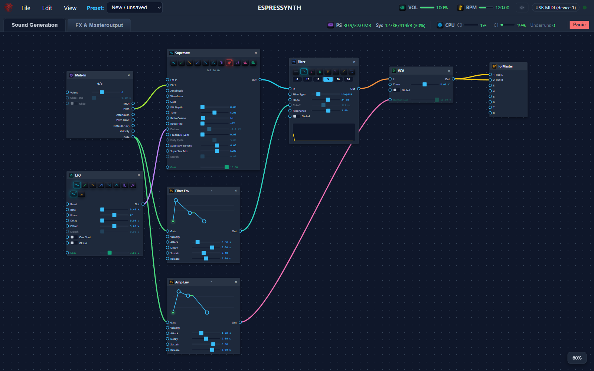
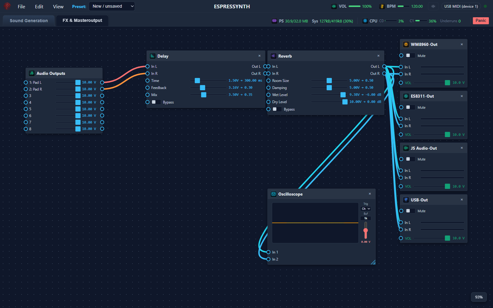
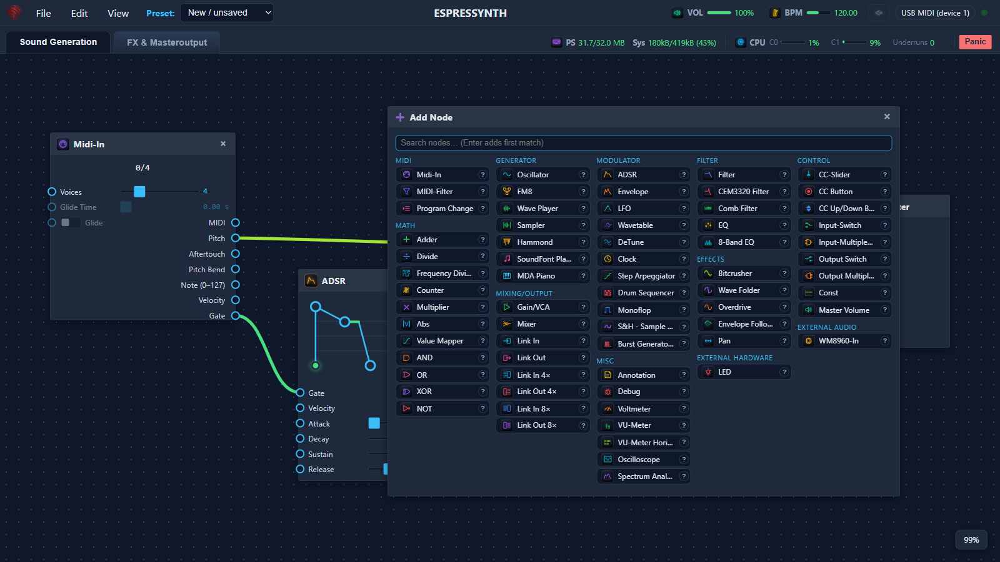

# Espressynth

A modular synthesizer that runs on the ESP32-P4. You build a patch in a browser: place nodes, draw cables between them, and the ESP32-P4 renders the resulting audio graph in real time. Sound comes out of the board's codec, over USB audio, or through a CV/gate interface. A touch display on the board gives you hands-on control.

Built with ESP-IDF 6.1 · [Apache License 2.0](LICENSE)



*Sound Generation page: MIDI-In drives a supersaw oscillator, an LFO modulates its detune, a filter envelope sweeps the low-pass filter, and an amp envelope opens the VCA before the signal goes to the master bus.*

## Highlights

- **Browser patch editor**, served by the device itself. Nothing to install; open the board's IP address in Chrome or Edge.
- **About 80 node types**: oscillators, an FM8 (DX7-compatible) engine, sample and SoundFont players, envelopes, sequencers, filters, effects, math and logic, meters and I/O. See [Nodes](#nodes).
- **Low latency**: about 11 ms from MIDI note-on to sound with the default settings (calculated, no underruns measured). See [Audio and latency](#audio-and-latency).
- **Polyphony** through the Midi-In node, with MIDI key filtering.
- **MIDI in** from USB devices (host), BLE MIDI, and a computer over USB (device mode).
- **Audio out** through ES8311, WM8960 and NS4168 codecs or USB Audio Class 2.0, plus **CV and gate** through external modules.
- **Build patches with an AI assistant** over [MCP](documentation/MCP.md): "build me a bass, then play a scale".
- **Safe start**: a bad preset or a lost network cannot lock you out of the device.
- **Browser preview**: the editor also renders the patch in the browser with a port of the firmware's engine.

## Supported boards

| Board | Display | Audio on board | Notes |
| --- | --- | --- | --- |
| JC8012P4A1 | 10.1" 1280x800 MIPI DSI, touch | ES8311 | ESP32-C6 co-processor |
| JC1060P470C | 7" 1024x600 MIPI DSI, touch | ES8311 | ESP32-C6 co-processor, Ethernet |
| Waveshare ESP32-P4-WIFI6-DEV-KIT | none | ES8311 | ESP32-P4 v1.x, Ethernet; WM8960 Audio HAT supported ([wiring](documentation/Boards/Waveshare_ESP32-P4-WIFI6_mit_WM8960_HAT.md)) |
| Elecrow CrowPanel Advanced 5" | 5" 800x480 parallel RGB, touch | NS4168 amp, PDM mic | ESP32-P4 v1.x |
| Custom ESP32-P4 board | configurable | configurable | all pins set in menuconfig |

Board data sheets and schematics are in [documentation/Boards](documentation/Boards). On the CrowPanel the speaker-output ferrites need to be removed for clean sound.

Add-on hardware is not tied to a board. Enable and wire it in menuconfig on whichever board it is attached to:

- WM8960 codec HAT, NS4168 amp or PDM microphone
- DFRobot ADS1115 (CV in, 0-10 V) and GP8413 (CV out, 2 channels, 15 bit)
- WS2812 LEDs and GPIO in/out nodes
- SD card

## Getting started

### Option A: flash a ready-made image

Release images for every board (merged bootloader, firmware, co-processor firmware, web editor and seed data) can be flashed from the browser with ESP Web Tools: [jolabi.de, Espressynth flashen](https://jolabi.de/de/projekte/espressynth/flashen). With `esptool`:

```powershell
python -m esptool --chip esp32p4 -p <COM-Port> write-flash 0x0 EspressiveSynths-<board>.bin
```

### Option B: build from source

Install ESP-IDF 6.1, open its environment, then:

```powershell
idf.py menuconfig      # Espressynth -> Board Configuration -> Target Board
idf.py build
idf.py -p <COM-Port> flash
idf.py monitor
```

`python tools/deploy.py` builds the same merged image as in option A for the board chosen in menuconfig (`build/EspressiveSynths-<board>.bin`). `python tools/deploy.py --all` builds release images for all boards except Custom.

On boards with an ESP32-C6 co-processor, the C6 firmware is built from `coprocessor_fw` and pushed from the P4 over the ESP-Hosted link. See [Co-processor firmware](#co-processor-firmware).

### First start

1. Without stored Wi-Fi credentials (or if the network is not reachable) the board opens an access point named **ESPRESSYNTH by Jolabi** with a captive portal (the name comes from `WIFI_CAPTIVE_PORTAL_SSID`). Join it; a gateway page such as `http://192.168.4.1/` opens.
2. Enter your home network under **File > Settings**. The access point switches off once the board is connected.
3. Find the board's IP address in your router, the serial monitor, or the `wifi` CLI command, and open `http://<ip>/`.
4. The default template is a playable voice. Plug in a MIDI keyboard and play.

The step-by-step guide is on the project website ([documentation/Website](documentation/Website)).

## The web editor



*FX & Masteroutput page: the voice buses run through delay and reverb into the hardware outputs and the in-browser preview.*

Each preset has at least two pages. **Sound Generation** holds the per-voice graph and ends in a *To Master* node with 8 audio buses. **FX & Masteroutput** is the shared master section that carries those buses through the effect chain to the outputs. The status bar shows master volume, BPM, the active MIDI device, free memory, load per core and audio underruns.



*Right-click on empty canvas to open the node picker.*

The [web editor guide](documentation/WebEditor.md) covers menus, canvas controls, settings and the file explorer. Every node also has a help page inside the editor.

### Nodes

| Group | Nodes |
| --- | --- |
| MIDI | Midi-In, Midi-Filter |
| Generators | Oscillator (with supersaw, FM and feedback), FM8 (DX7 voices, SysEx import, Dexed-style editor), Wave Player, Sampler (with editor), Hammond, SoundFont Player |
| Modulators | ADSR, DX Envelope, LFO, Wavetable (with editor), DeTune, Clock, Step Arpeggiator, Drum Sequencer, Monoflop, Sample & Hold, Burst Generator |
| Filters | Filter, Curtis Filter, Comb Filter, ESP-EQ, Graphic EQ |
| Control | Knob, Button, Up/Down Button, Switch, Multiplexer, Output Switch, Output Multiplexer, Const, Master Volume |
| Math and logic | Adder, Multiplier, Divide, Frequency Divider, Counter, Abs, Value Mapper, Logic AND/OR/XOR/NOT |
| Effects | Reverb Light, Chorus, Delay, Bitcrusher, Wave Folder, Overdrive, Envelope Follower, Pan |
| Mixing and output | Gain, Mixer, Linked Input/Output (1, 4 or 8 channels) |
| External audio | Audio-Out, USB-Out, ES8311-Out, WM8960-Out, NS4168-Out, Mic-In, WM8960-In |
| Meters and misc | Annotation, Debug, Voltmeter, VU Meter, Oscilloscope, Spectrum |
| External hardware | CV-In, CV-Out, Digital-In, Digital-Out, RGB LED |

### Build patches with an AI assistant (MCP)

The editor can be driven by Claude Code, Claude Desktop or any other MCP client. The assistant adds nodes, draws cables, sets parameters, plays notes and saves presets. MCP is off by default and protected by a token. See [documentation/MCP.md](documentation/MCP.md) for setup and the safety rules.

## Audio and latency

Audio runs at a fixed 44.1 kHz. Output latency is the sum of two stages, both set in menuconfig under **Application Features > Audio Subsystem**:

| Stage | Setting | Default | Time |
| --- | --- | --- | --- |
| I2S DMA ring | `AUDIO_I2S_DMA_DESC_NUM` x `AUDIO_I2S_DMA_FRAME_NUM` | 3 x 128 frames | 8.7 ms |
| Synth render block | `AUDIO_SYNTH_BLOCK_SIZE` | 128 samples | 2.9 ms |

That gives roughly 11 ms from a USB-MIDI note-on to sound (calculated). The render task keeps to its time budget per block; the status bar's *Underruns* counter should stay at 0. How the defaults were chosen and measured: [documentation/audio-latency.md](documentation/audio-latency.md). RAM use and PSRAM placement: [documentation/memory.md](documentation/memory.md).

The WM8960 codec also has a small runtime API (`Feature::Audio::WM8960` in `main/features/audio/wm8960_manager.hpp`) for headphone and speaker volume, DAC and ADC trim, line-input gain, mic boost and mic bias. The chip's control interface is write-only, so the getters return the last commanded value.

## Reliability

- **Safe start.** When the Wi-Fi co-processor cannot be reached with the boot preset, two starts in a row do not finish, or a finger rests on the touch screen at boot, the device starts without any preset and stays reachable. Nothing in your presets is changed. Details in `main/features/synth/SafeStart.h`.
- **Parameter journal.** Changes made on the device (knobs and buttons on the touch screen, with no browser open) are kept in a journal next to the preset. The editor applies them and writes them into the preset when autosave is on.
- **Deferred preset writes** (`PresetWriteCache`): saves from the browser are parked in PSRAM and written once the audio output has been silent for a moment, because flash writes cause dropouts while playing. A power loss during an uninterrupted performance loses the pending save.

## Configuration

There is exactly one configuration: the `sdkconfig` in the project root, edited with `idf.py menuconfig`. Always build with plain `idf.py build`: no `-B` build folders, no alternative `SDKCONFIG` files, no per-board `SDKCONFIG_DEFAULTS`. `sdkconfig.defaults` only seeds a fresh `sdkconfig`.

The board is picked under **Espressynth > Board Configuration > Target Board**, and the board derives everything its hardware fixes (see `main/Kconfig.projbuild`):

- Fixed pins have no input field on the built-in boards, so switching boards cannot leave the previous board's pins behind. Only the Custom board exposes all of them.
- Hardware a board lacks disappears from the menus (for example Ethernet on boards without a PHY).
- Fixed panels only offer their own display type and resolution.
- Features stay switchable on every board: audio, SD card, Wi-Fi/BLE, web server, USB host/device classes, I2C.
- Pins owned by other components (ESP-Hosted SDIO, console channel) are checked at compile time with `static_assert`, so a wrong leftover value fails the build with a pointer to the menuconfig entry.

### Co-processor firmware

Wi-Fi and BLE run on an ESP32-C6 attached over SDIO (ESP-Hosted). Build its firmware and stage it on the P4:

```powershell
cd coprocessor_fw
idf.py set-target esp32c6
idf.py build
build_and_stage.bat <COM-Port>
```

The image is written to the P4's `slave_fw` partition. At boot, the P4 compares versions and pushes the image to the C6 if needed. More in [coprocessor_fw/README.md](coprocessor_fw/README.md).

## Command line

A console (`esp_console`) is available over UART, USB Serial/JTAG or USB CDC. Commands include `top`/`htop`, `mem`, `uptime`, `version`, `chipinfo`, `wifi`, `eth`, `ble`, `usb`, `audio` (volume, mute, `tone` test generator), `i2c-scan`, `backlight`, `lvgl`, `df`, `fs`, `ping`, `coprocessor` and `reset`. Type `help` for the full list.

## Project layout

```text
ESP32P4_Espressynth/
├── main/
│   ├── audio/engine/    node-graph synth engine (nodes/, ports, graph builder, presets)
│   ├── boards/          board definitions: pins, panels, peripherals
│   ├── features/        audio, ble, display, ethernet, filesystem, hosted, io,
│   │                    sd_card, synth (manager, web API, presets), usb, web, wifi
│   ├── cli/             console commands
│   └── Kconfig.projbuild
├── components/          msfa (DX7 core), tiny_soundfont, crow_rgb_lcd, tinyusb, ...
├── data/                web editor (index.html, static/js, help pages), flashed to the www partition
├── littlefs_data/       seed data: presets, FM8 banks, samples, soundfonts
├── coprocessor_fw/      ESP32-C6 co-processor firmware
├── eezstudio/           touch UI project (EEZ Studio)
├── tools/               deploy.py, latency test, audio engine parity tests
├── documentation/       guides, board data sheets, website
└── partitions.csv       16 MB flash: factory app, slave_fw, www, littlefs
```

The firmware is split by feature. Time-critical audio and USB data paths run on `AUDIO_CORE`, everything else (network, HID, display, CLI) on `MAIN_CORE`. The web editor lives in its own `www` partition, so you can update it without rebuilding the firmware.

## Tests

`tools/audio_engine_parity` checks the browser preview engine against the firmware's node formulas. It renders offline in headless Chromium, so it needs no speakers:

```powershell
npm install playwright
node tools/audio_engine_parity/run.mjs
```

## Documentation

- [Web editor guide](documentation/WebEditor.md)
- [MCP: build patches with an AI assistant](documentation/MCP.md)
- [Audio latency](documentation/audio-latency.md)
- [Memory budget of the audio engine](documentation/memory.md)
- [Boards and Audio HAT wiring](documentation/Boards)
- [Build Your Own Synthesizer](documentation/Espressynth-Build-Your-Own-Synthesizer.md): script for the project video
- [Project website](documentation/Website) (German)

## What's new

Recent changes (full list in [ChangeLog.MD](ChangeLog.MD), written in German):

- MCP server: AI assistants can build and play patches through the editor.
- Parameter journal for knobs and buttons changed on the device.
- Lower audio latency (about 11 ms note-on to sound) and no boot underruns.
- New Midi-In node with key filtering, FM8 (DX7) widget with a Dexed-style editor, drum sequencer, multi-pattern step arpeggiator and more modulators.
- Support for the Elecrow CrowPanel Advanced 5" and a WS2812 RGB LED node.
- Browser preview brought in line with the firmware, with a parity test suite.
- Release images and web flashing through `tools/deploy.py`.
- The MDA Piano node was removed.
- The project now carries a license (Apache-2.0).

## License

Espressynth is licensed under the [Apache License 2.0](LICENSE); see also [NOTICE](NOTICE).

Third-party components (msfa, TinySoundFont, LVGL, littlefs, WM8960 driver and others) keep their own licenses, listed in [THIRD_PARTY_NOTICES.md](THIRD_PARTY_NOTICES.md). That file also names the source of the bundled DX7 voice banks: they are not covered by Apache-2.0, and all rights remain with Yamaha and the original authors.
