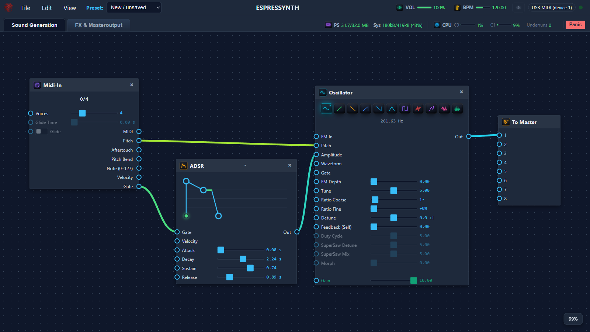
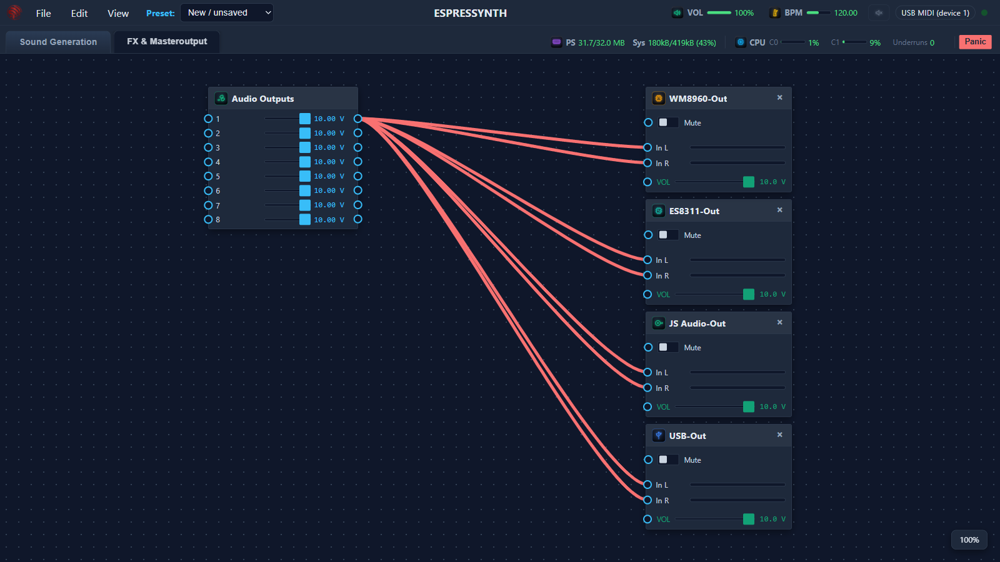
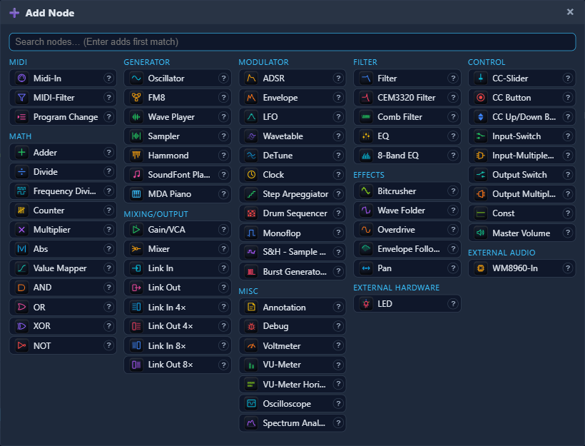
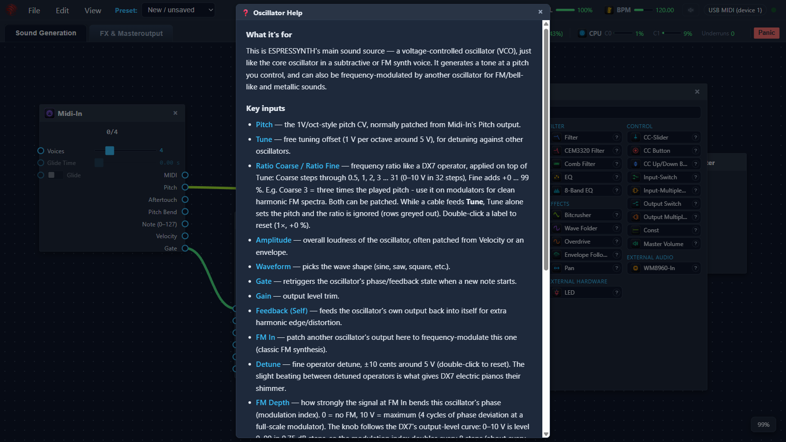
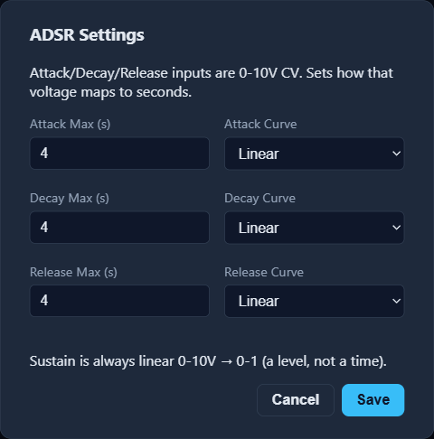
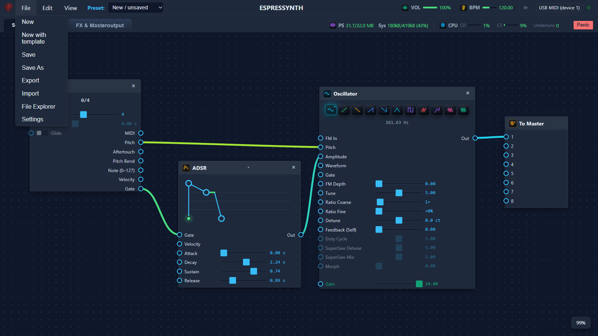
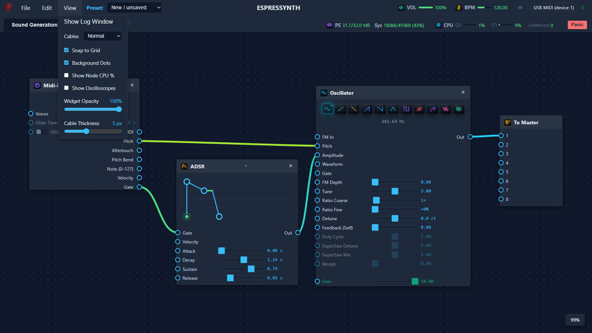
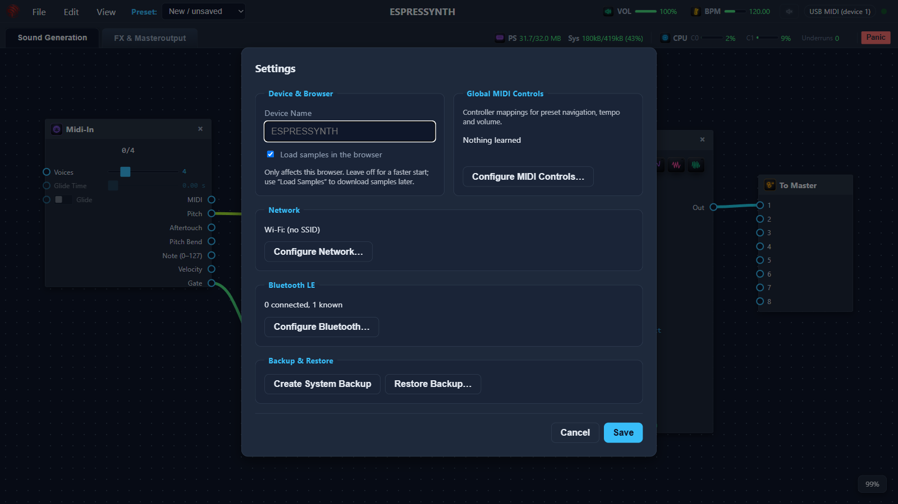
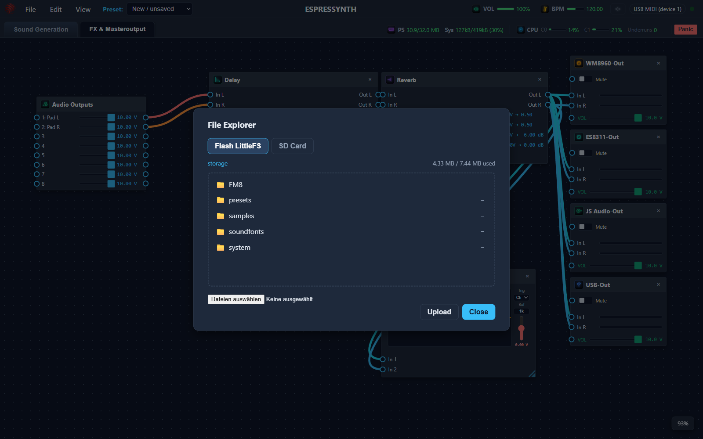

# Web Editor Guide

The ESP32-P4 serves the patch editor from its web partition. Open the device's IP address in a browser (Chrome or Edge recommended). Every change you patch in the browser is sent to the device, which rebuilds its audio graph.

Screenshots in this guide were taken on a Waveshare ESP32-P4 Wi-Fi 6 Dev Kit with WM8960 Audio HAT.

## Screen layout

- **Menu bar** (top left): File, Edit, View and the **Preset** selector. "New / unsaved" means the current patch has no preset name yet.
- **Status bar** (top right):
  - **VOL**: master volume.
  - **BPM**: master clock tempo, used by Clock, arpeggiator and sequencer nodes.
  - **MIDI device**: the active USB MIDI device and its connection LED.
  - **PS**: free PSRAM.
  - **Sys**: free internal heap.
  - **CPU C0 / C1**: load per core.
  - **Underruns**: audio buffer underruns. This should stay at 0.
  - **Panic**: sends all-notes-off and reloads the preset.
- **Page tabs**: each preset has at least two pages:
  - **Sound Generation**: the per-voice graph. It ends in **To Master**, which has 8 audio buses.
  - **FX & Masteroutput**: the shared master section. **Audio Outputs** delivers the 8 buses from the voice pages, and the effect chain feeds the hardware outputs.
- **Zoom indicator** (bottom right): current canvas zoom.

The output nodes on the FX page depend on the board configuration:

- **WM8960-Out** and **ES8311-Out**: on-board or HAT codecs.
- **USB-Out**: USB audio to a computer.
- **JS Audio-Out**: preview in the browser.

## Canvas controls

| Action | How |
| --- | --- |
| Add a node | Right-click on empty canvas |
| Connect | Drag from an output jack (right side of a node) to an input jack (left side) |
| Delete a cable | Double-click the cable |
| Recolour a cable | Right-click the cable |
| Open node settings | Double-click the node |
| Rename a node | Double-click its title |
| Delete a node | × in the node header |
| Select several nodes | Drag a lasso on empty canvas, or Shift/Ctrl-click nodes |
| Zoom | Mouse wheel |
| Pan | Drag with the middle mouse button |
| Fit everything into view | Middle-click on empty canvas |

All control signals use a 0–10 V range, like a hardware modular. Pitch follows 1 V per octave.

## Adding nodes

The picker groups nodes by category:

- MIDI
- Math
- Generator
- Mixing/Output
- Modulator
- Misc
- Filter
- Effects
- External hardware
- Control
- External audio

Type in the search field and press Enter to add the first match. The **?** next to each entry opens that node's help page:

## Node settings

Double-click a node to open its settings. Settings hold values that are not patchable inputs. For the ADSR, for example, they set the maximum time and curve of each stage:

## File menu

| Entry | What it does |
| --- | --- |
| New | Starts an empty patch: only the "To Master" link on Sound Generation and the "Audio Outputs" link on FX & Masteroutput |
| New with default template | Starts a new patch from the default template (MIDI-In → ADSR → Oscillator), plays on the device right away. Keep it with Save As |
| Save / Save As | Stores the preset on the device. Save asks for a name if the patch has none yet |
| Export / Import | Downloads the preset as JSON, or loads a JSON file from your computer |
| File Explorer | Browses the device's flash and SD card |
| Settings | Device name, MIDI controls, network, Bluetooth and backup |

Both start presets are plain preset files in `data/static/presets/` (`empty.json`, `default.json`); replace them to change what New loads.

## View menu

The View menu changes only how the editor looks in this browser:

- Log window
- Cable style: normal, sag, orthogonal or direct
- Snap to grid
- Background dots
- Per-node CPU display
- Inline oscilloscopes
- Widget opacity
- Cable thickness

## Settings

- **Device & Browser**: device name. *Load samples in the browser* controls whether this browser downloads sample data for its local preview.
- **Global MIDI Controls**: learn controller mappings for preset navigation, tempo and volume.
- **Network**: Wi-Fi credentials. Without a saved network, the device opens a setup hotspot.
- **Bluetooth LE**: scan for and pair BLE MIDI and HID devices.
- **Backup & Restore**: create a full system backup, or restore one.

## File Explorer

The File Explorer browses two volumes:

- **Flash LittleFS**: presets, samples, SoundFonts, FM8 banks and system files.
- **SD Card**: shown if a card is inserted.

Use **Upload** to copy files onto the selected volume.
